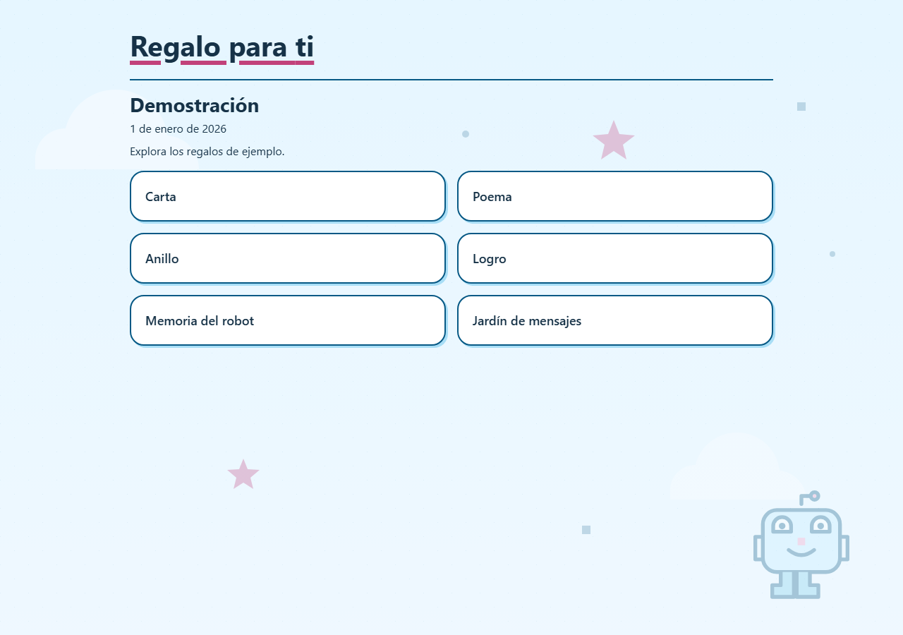

# cute-games

Plantilla web estática para regalos: una línea de tiempo por fecha y seis tipos de vista reutilizables.

1. **Carta** y **poema**, con formato de párrafos y estrofas.
2. **Anillo** y **logro**, con contenido breve.
3. **Memoria del robot** y **jardín de mensajes**, mini-juegos configurables.

El diseño permite agregar regalos y, más adelante, mini-juegos, sin duplicar la navegación ni los
componentes compartidos.

## Estado

**Fase 2: P1–P9 completadas.** La plantilla incluye `ContentBundle`, menú por fechas, temas, mini-juegos,
guía de reutilización y validación diferenciada de releases. El despliegue de una instancia personal
queda fuera de alcance.

La fase 2 separa el motor público del contenido privado: contrato `ContentBundle`, menú por fecha,
temas configurables, mini-juegos y demo neutra. El plan y el estado están en
[`docs/work/regalo-publico/PLAN.md`](docs/work/regalo-publico/PLAN.md) y
[`docs/work/regalo-publico/HANDOFF.md`](docs/work/regalo-publico/HANDOFF.md).

## Stack

| Capa | Decisión |
|---|---|
| UI | React 19.3.1 + TypeScript 7.0.2 |
| Build | Vite 8.3.5 + `@vitejs/plugin-react` 6.1.2 |
| Estilos | CSS propio adaptable y accesible |
| Rutas | Hash routes (`#/`, `#/regalo/<id>`) |
| Contenido | `ContentBundle` en `src/content/` y textos en `src/content/texts/`; demo de ejemplo |
| Tests | Vitest 5.0.5 (unitarias) + Playwright 1.64.1 (E2E) |
| Hosting | Sitio estático con HTTPS; proveedor pendiente |
| Licencia | MIT |

## Puesta en marcha

Requiere Node.js 22.12 o superior (verificado con 24.16.0) y npm (verificado con 11.16.0).

```bash
npm install
npm run dev              # servidor local en http://localhost:5173
npm run typecheck        # comprobación de tipos con tsc
npm run test             # pruebas unitarias con Vitest
npm run test:e2e         # build + pruebas E2E con Playwright
npm run build            # typecheck + build estático en dist/
npm run preview          # sirve dist/ localmente
npm run validate:release # valida la huella pública y el dist/ ya construido
npm run build:release    # build + validación de la demo pública
npm run build:release:personal # build + validación de contenido completo; solo local
```

`npm run build` genera `dist/index.html` y los assets con hash; no requiere backend ni servicios
externos. `npm run test:e2e` construye el sitio, lo sirve con `vite preview` y recorre las vistas,
retorno, ruta inválida, mini-juegos, teclado, movimiento reducido y los cuatro anchos de referencia.
La primera vez hay que instalar el navegador de Playwright con `npx playwright install chromium`.

La captura siguiente muestra el menú neutro de la demo:



## Usar la plantilla

1. Crea un repositorio nuevo **privado** derivado de la plantilla; no uses un fork público para el contenido real.
2. Configura este repositorio como `upstream` y el privado como `origin`.
3. Reemplaza `src/content/demo.ts` y `src/content/texts/` con contenido aprobado y assets autorizados.
4. Sigue [`REPOS.md`](docs/work/regalo-publico/REPOS.md), [`CONTENT.md`](docs/work/regalo-publico/CONTENT.md)
   y [`RELEASE.md`](docs/work/regalo-publico/RELEASE.md); revisa el build personal solo en local.

El contenido personal no se publica en este repositorio. Un repositorio privado no es control de
acceso: un build estático contiene el contenido y es legible si se sirve en la web. Detalle en
[`docs/work/regalo-publico/REPOS.md`](docs/work/regalo-publico/REPOS.md) y
[`docs/work/regalo-publico/PRIVACY.md`](docs/work/regalo-publico/PRIVACY.md).

## Editar los textos

La carta, el poema, el mensaje del anillo y la felicitación están en `src/content/texts/` como
archivos `.txt` separados. Las definiciones de cada regalo —`id`, `kind`, título, `order` y asset—
viven en el `ContentBundle` de `src/content/demo.ts`. Los textos y la fecha actuales son de ejemplo y
deben reemplazarse por el contenido real. El formato de cada archivo está documentado en
[`docs/work/regalo-publico/CONTENT.md`](docs/work/regalo-publico/CONTENT.md).

## Rutas

- `#/` — menú cronológico con las ocasiones y regalos configurados.
- `#/regalo/<id>` — detalle; ids de demo incluyen `carta`, `poema`, `anillo`, `logro`, `memoria-robot` y `jardin-mensajes`.
- Cualquier otra ruta muestra un estado recuperable con retorno al menú.

## Accesibilidad

- Enlace “Saltar al contenido”, foco visible y navegación completa por teclado.
- Al cambiar de ruta, el foco pasa al contenido principal y el título del documento se actualiza.
- Sin scroll horizontal en 320, 375, 768 y 1024 px.
- Se respeta `prefers-reduced-motion`; ninguna información depende de una animación.
- Objetivo WCAG 2.1 AA. Verificado con Playwright/Chrome en los cuatro anchos; la revisión en
  Safari/VoiceOver de iPhone sigue pendiente.

## Documentación

| Necesito… | Ir a |
|---|---|
| Entender el producto y las decisiones | [`docs/PROJECT_CONTEXT.md`](docs/PROJECT_CONTEXT.md) |
| Retomar el trabajo activo | [`docs/work/regalo-publico/HANDOFF.md`](docs/work/regalo-publico/HANDOFF.md) |
| Ver el plan de la plantilla | [`docs/work/regalo-publico/PLAN.md`](docs/work/regalo-publico/PLAN.md) |
| Usar la plantilla en un repo privado | [`docs/work/regalo-publico/REPOS.md`](docs/work/regalo-publico/REPOS.md) |
| Editar los textos | [`docs/work/regalo-publico/CONTENT.md`](docs/work/regalo-publico/CONTENT.md) |
| Validar y auditar un release | [`docs/work/regalo-publico/RELEASE.md`](docs/work/regalo-publico/RELEASE.md) |
| Ver la política de assets | [`docs/work/regalo-publico/ASSETS.md`](docs/work/regalo-publico/ASSETS.md) |
| Conocer las reglas para agentes | [`AGENTS.md`](AGENTS.md) |
| Ver el mapa de docs | [`docs/README.md`](docs/README.md) |

## Licencia

El código de este repositorio se distribuye bajo la **Licencia MIT**. Consulta [`LICENSE`](LICENSE)
para los términos completos: se permite usar, copiar, modificar y distribuir el código conservando
el aviso de copyright y el texto de la licencia.

La licencia cubre el código propio, no el contenido personal ni assets de terceros. Cada asset
incorporado debe tener procedencia, permiso y atribución documentados. Los personajes y marcas de
terceros no se incluyen en este repositorio ni en su build.

## Privacidad

Este repositorio es público y no contiene contenido personal. Si vas a usarlo para un regalo real,
mantén los textos, las fechas y los assets en un repositorio privado y no publiques el build. Una URL
difícil de adivinar no es control de acceso.
